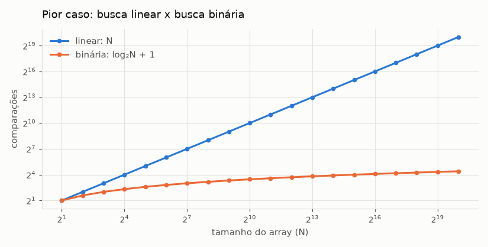
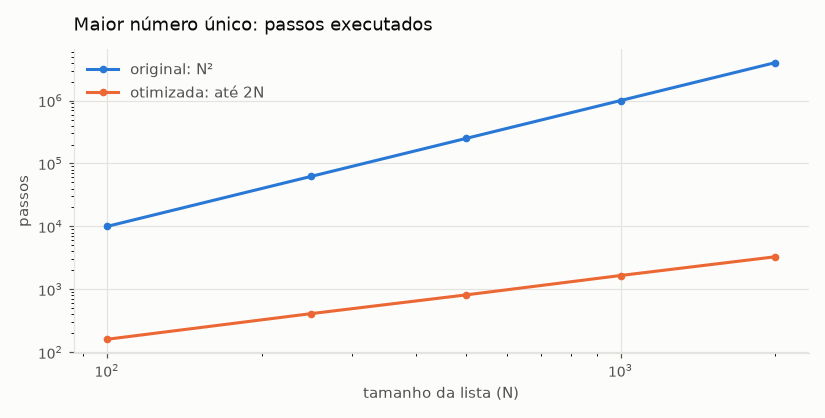
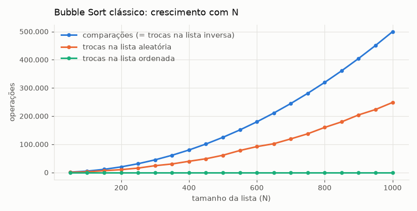
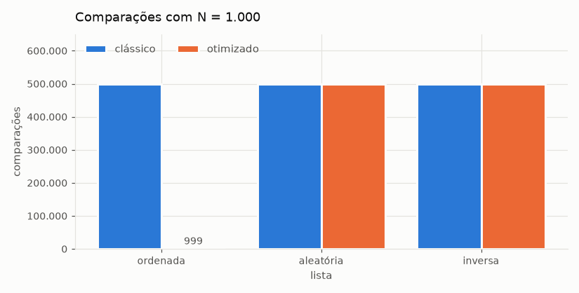
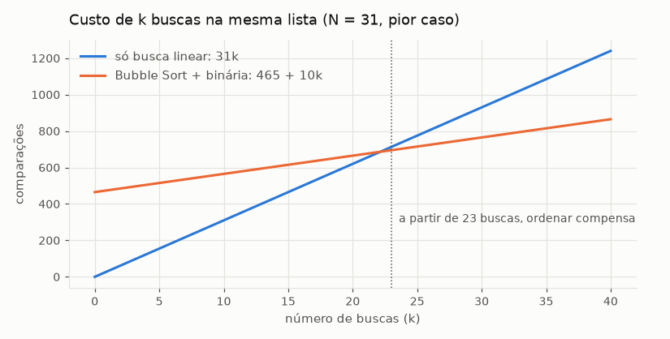
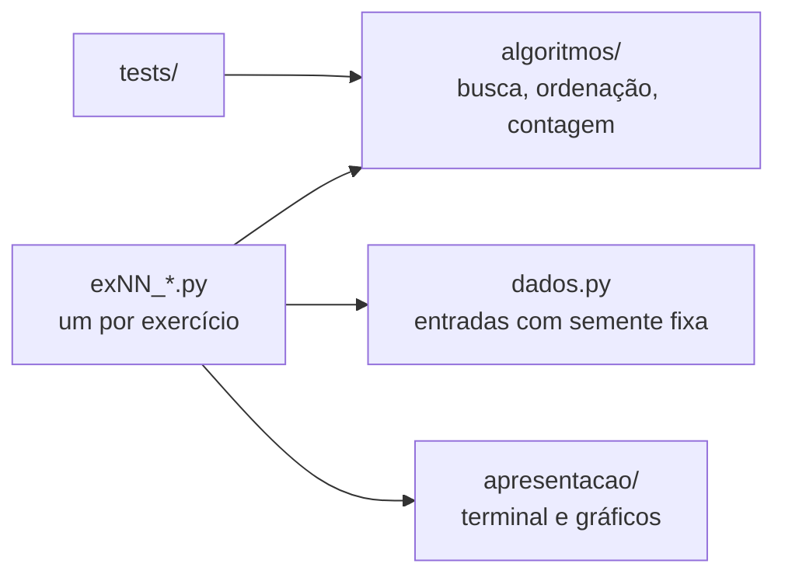

<div align="center">


# 🔎 Busca, Ordenação e Big O

**Busca linear e binária, Bubble Sort e suas variações, com contagem de operações e análise de complexidade em Python**

<sub>DR1-TP1 · Bloco Ciência da Computação · Trabalho individual</sub>

<br/>

[](docs/RELATORIO_TP1.md)
[](DR1_TP1.ipynb)

<br/>

[](#stack)
[](#stack)
[](DR1_TP1.ipynb)
[](#graficos)
[](#testes)
[%20%C2%B7%20O(log%20N)%20%C2%B7%20O(N)%20%C2%B7%20O(N%C2%B2)-6250D6?style=flat-square)](#exercicios)
[](LICENSE)
[](#estado)

<br/>



<sub>Pior caso da busca linear e da busca binária para N de 2 a 1.000.000 (Exercício 4).</sub>

</div>

---

<a id="indice"></a>

## 📚 Índice

| | O trabalho | | Qualidade e entrega |
|:---:|---|:---:|---|
| 01 | [Visão geral](#visao-geral) | 07 | [Testes automatizados](#testes) |
| 02 | [Os 14 exercícios](#exercicios) | 08 | [Atendimento à rúbrica](#atendimento) |
| 03 | [Gráficos](#graficos) | 09 | [Estrutura do projeto](#estrutura) |
| 04 | [Arquitetura](#arquitetura) | 10 | [Estado do projeto](#estado) |
| 05 | [Stack](#stack) | 11 | [Referências](#referencias) |
| 06 | [Como executar](#como-executar) | 12 | [Licença](#licenca) |

---

<a id="visao-geral"></a>

## 💡 Visão geral

Teste de Performance com 14 exercícios sobre busca e ordenação. Em todos eles eu meço a eficiência
contando passos (comparações, trocas e iterações), e não tempo, como na Aula 1, e uso a notação Big O
para explicar como o custo cresce com o tamanho da entrada:

- **busca linear e binária**, instrumentadas e simuladas passo a passo no array do quiz da Aula 2;
- **Bubble Sort** clássico, com parada antecipada e bidirecional (Cocktail Sort), para números e
  para palavras;
- **otimização** de um algoritmo O(N²) para O(N) com dicionário;
- **crescimento exponencial** no problema do tabuleiro de xadrez com grãos de arroz;
- **comparação de estratégias**: quando vale ordenar antes para usar a busca binária;
- **refatoração** com teste de equivalência contra o código original.

Cada script confere o próprio resultado e imprime `[OK]` ou `[FALHA]`. Os dados aleatórios usam
`random.seed(42)`, então os números se repetem em toda execução.

> **Bloco:** Ciência da Computação  
> **Disciplina:** Velocidade e Qualidade com Estruturas de Dados e Algoritmos  
> **Trimestre:** 26E4  
> **Professor:** Ian Monteiro Nunes  
> **Aluno:** André Luis Becker  
> **Sala:** GRLENGR2C2-N2-L1  
> **Modalidade:** Individual

> **Repositório:** https://github.com/andrebecker84/dr1-tp1-estruturas-de-dados  
> **Notebook:** [DR1_TP1.ipynb](https://github.com/andrebecker84/dr1-tp1-estruturas-de-dados/blob/main/DR1_TP1.ipynb)

> [!IMPORTANT]
> **Leituras do enunciado.**
> - **Exercício 2:** o enunciado fala em "restrições apresentadas", mas o texto recebido não as traz.
>   Adotei as restrições clássicas do problema (só duas cartas vizinhas nas mãos, só trocas entre
>   vizinhas, sem espaço extra) e as declarei no relatório.
> - **Contagem da busca binária:** nos Exercícios 3 e 4, cada inspeção do meio conta 1 passo, como
>   nos slides. Nos Exercícios 13 e 14, o teste de igualdade e o de direção contam separadamente,
>   como no código fornecido no Exercício 14. A constante 2 não muda o Big O.
> - **Nome do arquivo de entrega:** o enunciado pede `nome_sobrenome_DR2_TP1.PDF`, mas a disciplina é
>   o DR1; o PDF segue o código da disciplina.

<p align="right"><a href="#indice">⬆ voltar ao índice</a></p>

---

<a id="exercicios"></a>

## 🧭 Os 14 exercícios

| Ex. | Tema | Resultado principal | Big O | Detalhes |
|:---:|---|---|---|:---:|
| 1 | Busca linear instrumentada | 1 comparação para o alvo na 1ª posição | O(N) | [ver](docs/RELATORIO_TP1.md#exercicio-1) |
| 2 | Ordenação das 13 cartas | é o Bubble Sort: 78 comparações no pior caso | O(N²) | [ver](docs/RELATORIO_TP1.md#exercicio-2) |
| 3 | Busca linear manual | 4 comparações para achar o 8 | O(N) | [ver](docs/RELATORIO_TP1.md#exercicio-3) |
| 4 | Busca binária manual | 1 comparação para achar o 8 | O(log N) | [ver](docs/RELATORIO_TP1.md#exercicio-4) |
| 5 | Maior número único | 1.000.000 → 1.625 passos com N = 1.000 | O(N²) → O(N) | [ver](docs/RELATORIO_TP1.md#exercicio-5) |
| 6 | Tabuleiro e grãos de arroz | 1.000.000 de grãos → quadrado 21 | O(log Q) | [ver](docs/RELATORIO_TP1.md#exercicio-6) |
| 7 | Análise de `only_a_strings` | N iterações e no máximo 3N operações | O(N) | [ver](docs/RELATORIO_TP1.md#exercicio-7) |
| 8 | Cocktail Sort | 66 → 30 comparações com o menor valor no fim | O(N²) | [ver](docs/RELATORIO_TP1.md#exercicio-8) |
| 9 | Bubble Sort numérico | 9 listas de teste e 500 aleatórias corretas | O(N²) | [ver](docs/RELATORIO_TP1.md#exercicio-9) |
| 10 | Bubble Sort para strings | ordem lexicográfica x ordem alfabética | O(N²) | [ver](docs/RELATORIO_TP1.md#exercicio-10) |
| 11 | Bubble Sort instrumentado | 499.500 comparações com N = 1.000 | O(N²) | [ver](docs/RELATORIO_TP1.md#exercicio-11) |
| 12 | Bubble Sort otimizado | lista ordenada: 499.500 → 999 comparações | O(N) no melhor caso | [ver](docs/RELATORIO_TP1.md#exercicio-12) |
| 13 | Linear x binária | ordenar antes compensa a partir de 23 buscas | O(N) x O(log N) | [ver](docs/RELATORIO_TP1.md#exercicio-13) |
| 14 | Refatoração | 4 testes de equivalência passando | O(log N) e O(N²) | [ver](docs/RELATORIO_TP1.md#exercicio-14) |

Cada exercício no [relatório técnico](docs/RELATORIO_TP1.md) traz o enunciado, a teoria das aulas, o
trecho de código, o print da execução no terminal e a minha resposta. O
[notebook](DR1_TP1.ipynb) tem o mesmo conteúdo, com o código executado e os gráficos.

<p align="right"><a href="#indice">⬆ voltar ao índice</a></p>

---

<a id="graficos"></a>

## 📈 Gráficos

<table>
<tr>
<td width="50%"><br/><sub><b>Ex. 5</b> · laço aninhado O(N²) contra dicionário O(N)</sub></td>
<td width="50%"><br/><sub><b>Ex. 11</b> · comparações e trocas crescem como N²</sub></td>
</tr>
<tr>
<td width="50%"><br/><sub><b>Ex. 12</b> · a parada antecipada só ajuda na lista ordenada</sub></td>
<td width="50%"><br/><sub><b>Ex. 13</b> · ordenar compensa a partir de 23 buscas</sub></td>
</tr>
</table>

<p align="right"><a href="#indice">⬆ voltar ao índice</a></p>

---

<a id="arquitetura"></a>

## 🏗️ Arquitetura



| Camada | Pasta | Papel |
|---|---|---|
| Modelo | `src/algoritmos/` | Buscas e ordenações puras: recebem dados, devolvem resultado, sem `print` |
| Visão | `src/apresentacao/` | Tabelas e `[OK]`/`[FALHA]` no terminal, gráficos no notebook |
| Controle | `src/exNN_*.py` | Monta os dados do exercício, chama o núcleo e manda para a visão |
| Testes | `src/tests/` | 15 testes do núcleo e os 4 de equivalência do Exercício 14 |

### 🧩 Princípios aplicados

- **DRY:** cada algoritmo existe uma vez. Os Exercícios 2 e 8 a 14 usam o mesmo Bubble Sort.
- **Responsabilidade única:** algoritmo, contagem (`Metricas`), dados, verificação e saída ficam em
  módulos separados; cada `main()` só chama funções curtas com nomes que dizem o que mostram.
- **Strategy:** a ordem do Bubble Sort vem de uma função `chave`. O Exercício 10 ordena palavras só
  passando `chave_alfabetica`.
- **Observer:** os callbacks `ao_comparar`, `ao_inspecionar` e `ao_fim_da_passagem` mostram o passo
  a passo dos Exercícios 2, 3 e 4 sem colocar `print` dentro do algoritmo.
- **Adapter:** `algoritmos/contagem.py` expõe os nomes e retornos exigidos no Exercício 13 sobre o
  núcleo em português.
- **YAGNI:** o núcleo não depende de entrada e saída, que é a ideia central da arquitetura
  hexagonal, mas não criei interfaces formais: há um único adaptador de cada lado.

<p align="right"><a href="#indice">⬆ voltar ao índice</a></p>

---

<a id="stack"></a>

## 🛠️ Stack

| Item | Uso |
|---|---|
| **Python 3.15.2** | Versão de desenvolvimento, no Windows 11. Requer Python 3.11 ou superior (`enum.StrEnum`). |
| **Python 3.12.3** | Ubuntu 24.04 no WSL2, onde rodaram as execuções dos prints e o vídeo. Saídas idênticas às do 3.15.2. |
| **Biblioteca padrão** | `random`, `math`, `unicodedata`, `collections`, `enum`, `dataclasses`, `unittest`. Os exercícios não têm dependência externa. |
| **Jupyter + matplotlib** | Só no notebook e nos gráficos. O notebook é executado no Python 3.12, porque o `matplotlib` ainda não tem pacote para o 3.15. |
| **tmux + Pillow** | Captura das telas do terminal, sem edição, em `scripts/`. |

<p align="right"><a href="#indice">⬆ voltar ao índice</a></p>

---

<a id="como-executar"></a>

## ▶️ Como executar

### Pré-requisitos

- Python 3.11 ou superior. Nada para instalar além dele.

### Exercícios

Cada exercício é um script independente, executado de dentro de `src/`:

```bash
cd src
python ex01_busca_linear.py
python ex13_comparacao_buscas.py
```

### Testes

```bash
cd src
python -m unittest discover -s tests -t . -v
```

### Notebook

Abra o [`DR1_TP1.ipynb`](DR1_TP1.ipynb) aqui no GitHub, que já mostra as saídas e os gráficos, ou
no VS Code e no Jupyter. Para executar de novo, os gráficos precisam do `matplotlib`.

> [!TIP]
> No Linux e no WSL, use `python3` no lugar de `python`. Os resultados são os mesmos em qualquer
> sistema, por causa da semente fixa.

<p align="right"><a href="#indice">⬆ voltar ao índice</a></p>

---

<a id="testes"></a>

## ✅ Testes automatizados

| Arquivo | Testes | O que confere |
|---|:---:|---|
| `src/tests/test_algoritmos.py` | 15 | buscas (achar, não achar, lista vazia, limite log N), as três ordenações (resultado, entrada intacta, N(N−1)/2 comparações, parada antecipada, trocas = inversões, chave alfabética), maior único e tabuleiro |
| `src/tests/test_ex14_refatoracao.py` | 4 | o código refatorado devolve exatamente o mesmo resultado e o mesmo contador que o `f` e o `h` originais, em 207 listas |

```text
$ python -m unittest discover -s tests -t .
...................
----------------------------------------------------------------------
Ran 19 tests

OK
```

<p align="right"><a href="#indice">⬆ voltar ao índice</a></p>

---

<a id="atendimento"></a>

## 🎯 Atendimento à rúbrica

| Critério | Onde está |
|---|---|
| Implementa corretamente algoritmos de busca e ordenação | Ex. 1, 3, 4, 8, 9, 10, 13 e 14, todos com verificação `[OK]` e testes |
| Instrumenta algoritmos para contar comparações e trocas | Objeto `Metricas` em todas as buscas e ordenações |
| Analisa o comportamento em função do tamanho da entrada | Tabelas com N crescente nos Ex. 1, 4, 5, 7, 11 e 12, e os gráficos |
| Identifica diferenças de custo entre abordagens | Linear x binária (Ex. 4 e 13), O(N²) x O(N) (Ex. 5), Bubble x Cocktail (Ex. 8), clássico x otimizado (Ex. 12) |
| Expressa a complexidade com Big O corretamente | Resposta de cada exercício, com melhor e pior caso quando diferem |
| Relaciona resultados empíricos com a análise assintótica | N(N−1)/2 nos Ex. 11 e 13, log₂N no Ex. 4, 3N no Ex. 7, ponto de equilíbrio no Ex. 13 |
| Identifica gargalos em estruturas de repetição | Laço aninhado (Ex. 5), varredura sequencial (Ex. 1), passagens sem troca (Ex. 12), menor valor no fim (Ex. 8) |
| Reduz a complexidade preservando a corretude | Ex. 5: O(N²) → O(N), com o mesmo resultado em 56 casos |
| Justifica escolhas e conclusões com clareza | Teoria e resposta de cada exercício e a conclusão do Ex. 13 |
| Organização, clareza e legibilidade do código | Núcleo sem I/O, um script por exercício, refatoração testada do Ex. 14 |

<p align="right"><a href="#indice">⬆ voltar ao índice</a></p>

---

<a id="estrutura"></a>

## 📁 Estrutura do projeto

```
DR1_TP1/
├── DR1_TP1.ipynb            notebook com o trabalho completo
├── LICENSE                  licença de código visível, com o aviso LGPD
├── src/
│   ├── algoritmos/          busca, ordenação, contagem e métricas (sem entrada e saída)
│   ├── apresentacao/        terminal e gráficos
│   ├── tests/               testes do núcleo e do Exercício 14
│   ├── dados.py             entradas dos experimentos
│   ├── verificacao.py       conferência das ordenações
│   └── ex01 ... ex14        um script por exercício
├── docs/
│   ├── RELATORIO_TP1.md     relatório técnico, com os prints
│   ├── context/             enunciado e rúbrica
│   └── molde/               modelo do documento de entrega
├── evidencias/
│   ├── telas/               prints do terminal
│   ├── graficos/            gráficos do notebook
│   └── saidas/              saída de cada exercício em texto
└── scripts/                 geram as telas, o notebook e o documento de entrega
```

<p align="right"><a href="#indice">⬆ voltar ao índice</a></p>

---

<a id="estado"></a>

## 📌 Estado do projeto

Entrega concluída. Os 14 exercícios estão implementados, executados e documentados, e os 19 testes
passam. O documento de entrega (`andre_becker_DR1_TP1.pdf`, com os prints e o link do vídeo) vai pela
plataforma do Infnet e não é versionado aqui.

<p align="right"><a href="#indice">⬆ voltar ao índice</a></p>

---

<a id="referencias"></a>

## 📖 Referências

- Slides das Aulas 1 a 5 da disciplina, prof. Ian Monteiro Nunes (Instituto Infnet, 2026).
- WENGROW, J. *A Common-Sense Guide to Data Structures and Algorithms*. Caps. 1 a 7.
- BHARGAVA, A. *Grokking Algorithms*. Caps. 1 e 2.
- GOODRICH, M.; TAMASSIA, R.; GOLDWASSER, M. *Data Structures and Algorithms in Python*. Caps. 1 a 3.

<p align="right"><a href="#indice">⬆ voltar ao índice</a></p>

---

<a id="licenca"></a>

## 📜 Licença

Copyright © 2026 André Luis Becker. Todos os direitos reservados, sobre a contribuição original
deste trabalho.

Este repositório é **de código visível (source-available), não de código aberto**. É público para
ser lido, estudado e avaliado, e o corpo docente da instituição avaliadora pode executá-lo
livremente para conferir a entrega. Qualquer outro uso, incluindo clonar, executar, modificar ou
redistribuir, depende de autorização escrita.

O enunciado, a rúbrica e os trechos de código fornecidos pelo professor não são alcançados por esta
licença e seguem os termos de seus autores.

Os termos completos, com o anexo de proteção de dados (LGPD), estão na [LICENSE](LICENSE). Pedidos
de autorização são gratuitos: abra uma [issue](https://github.com/andrebecker84/dr1-tp1-estruturas-de-dados/issues).

<p align="right"><a href="#indice">⬆ voltar ao índice</a></p>
