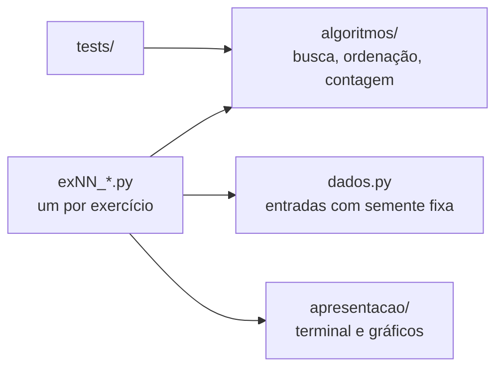

# DR1 TP1: Velocidade e Qualidade com Estruturas de Dados e Algoritmos


Teste de Performance da disciplina Velocidade e Qualidade com Estruturas de Dados e Algoritmos
(Instituto Infnet, trimestre 26E4, prof. Ian Monteiro Nunes). Aluno: André Luis Becker.

São 14 exercícios sobre busca linear, busca binária e Bubble Sort. Em todos eu conto as operações
(comparações e trocas) em vez de medir tempo, e uso a notação Big O para explicar o crescimento.


## Onde ler

| Arquivo | O que tem |
|---|---|
| [`DR1_TP1.ipynb`](DR1_TP1.ipynb) | **O trabalho completo:** enunciado, teoria das aulas, código executado, gráficos e resposta de cada exercício |
| [`docs/tp1.md`](docs/tp1.md) | O mesmo conteúdo em Markdown, com os prints do terminal |
| [`src/`](src) | Núcleo de algoritmos, um script por exercício e os testes |

## Resultados

| Ex. | Tema | Resultado principal | Big O |
|---|---|---|---|
| 1 | Busca linear instrumentada | 1 comparação para o alvo na 1ª posição | O(N) |
| 2 | Ordenação das 13 cartas | é o Bubble Sort: 78 comparações no pior caso | O(N²) |
| 3 | Busca linear manual | 4 comparações para achar o 8 | O(N) |
| 4 | Busca binária manual | 1 comparação para achar o 8 | O(log N) |
| 5 | Maior número único | 1.000.000 → 1.625 passos com N = 1.000 | O(N²) → O(N) |
| 6 | Grãos de arroz | 1.000.000 de grãos → quadrado 21 | O(log Q) |
| 7 | Análise de `only_a_strings` | N iterações e no máximo 3N operações | O(N) |
| 8 | Cocktail Sort | 66 → 30 comparações com o menor valor no fim | O(N²) |
| 9 | Bubble Sort numérico | 9 listas de teste e 500 aleatórias corretas | O(N²) |
| 10 | Bubble Sort para strings | ordem lexicográfica x ordem alfabética | O(N²) |
| 11 | Bubble Sort instrumentado | 499.500 comparações com N = 1.000 | O(N²) |
| 12 | Bubble Sort otimizado | lista ordenada: 499.500 → 999 comparações | O(N) no melhor caso |
| 13 | Linear x binária | ordenar antes compensa a partir de 23 buscas | O(N) x O(log N) |
| 14 | Refatoração | 4 testes de equivalência passando | O(log N) e O(N²) |

<table>
<tr>
<td></td>
<td></td>
</tr>
</table>

## Arquitetura



| Camada | Pasta | Papel |
|---|---|---|
| Modelo | `src/algoritmos/` | Buscas e ordenações puras: recebem dados, devolvem resultado, sem `print` |
| Visão | `src/apresentacao/` | Tabelas e `[OK]`/`[FALHA]` no terminal, gráficos no notebook |
| Controle | `src/exNN_*.py` | Monta os dados do exercício, chama o núcleo e manda para a visão |
| Testes | `src/tests/` | 19 testes do núcleo e a equivalência pedida no Exercício 14 |

O que apliquei e onde:

- **DRY:** cada algoritmo existe uma vez. Antes eram 8 cópias do Bubble Sort e 3 da busca binária;
  agora os Exercícios 2 e 8 a 14 usam o mesmo `bubble_sort`.
- **Responsabilidade única:** algoritmo, contagem (`Metricas`), dados, verificação e saída ficam em
  módulos separados, e cada `main()` só chama funções curtas com nomes que dizem o que mostram.
- **Aberto para extensão:** a ordem do Bubble Sort vem de uma função `chave` (padrão Strategy). O
  Exercício 10 ordena palavras sem mudar o algoritmo, só passando `chave_alfabetica`.
- **Observer:** `ao_comparar`, `ao_inspecionar` e `ao_fim_da_passagem` deixam os Exercícios 2, 3 e 4
  mostrarem o passo a passo sem colocar `print` dentro do algoritmo.
- **Adapter:** `algoritmos/contagem.py` expõe os nomes e retornos exigidos no Exercício 13
  (`linear_search_count`, ...) sobre o núcleo em português.
- **Clean code:** nomes descritivos, constantes no lugar de números soltos, `Cenario` como enum em
  vez de texto, e `bubble_sort` / `bubble_sort_com_parada` em vez de um parâmetro booleano.
- **YAGNI:** o núcleo não depende de entrada e saída, que é a ideia central da arquitetura
  hexagonal. Não criei interfaces e adaptadores formais porque há um único adaptador de cada lado
  (terminal e notebook): seria código sem uso.

## Como rodar

Os exercícios usam só a biblioteca padrão do Python 3.

```bash
cd src
python3 ex01_busca_linear.py
python3 -m unittest discover -s tests -t . -v
```

O notebook também usa `matplotlib` nos gráficos. Os dados aleatórios usam `random.seed(42)`, então
os números saem sempre iguais aos do notebook.


## Estrutura

```
DR1_TP1/
├── DR1_TP1.ipynb            notebook com o trabalho completo
├── src/
│   ├── algoritmos/          busca, ordenação, contagem e métricas (sem entrada e saída)
│   ├── apresentacao/        terminal e gráficos
│   ├── tests/               testes do núcleo e do Exercício 14
│   ├── dados.py             entradas dos experimentos
│   ├── verificacao.py       conferência das ordenações
│   └── ex01 ... ex14        um script por exercício
├── docs/
│   ├── tp1.md               conteúdo do notebook e do PDF, com os prints
│   └── context/             enunciado e rubrica
├── evidencias/
│   ├── telas/               prints do terminal
│   ├── graficos/            gráficos do notebook
│   └── saidas/              saída de cada exercício em texto
└── scripts/                 geram as telas, o notebook e o PDF
```
